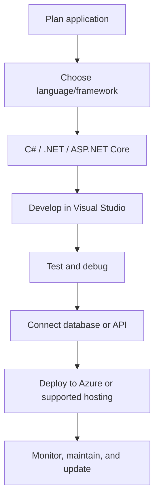
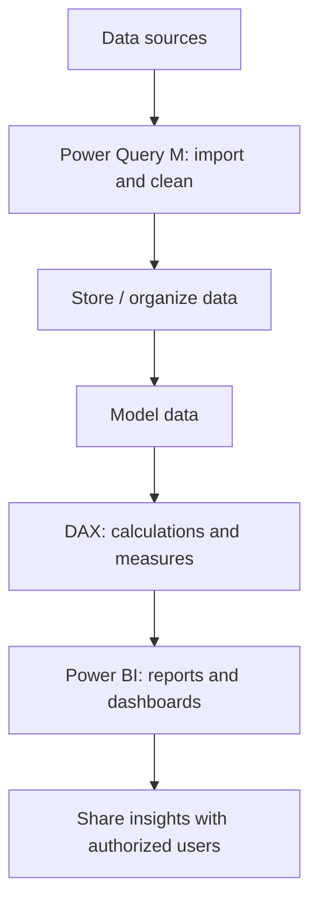
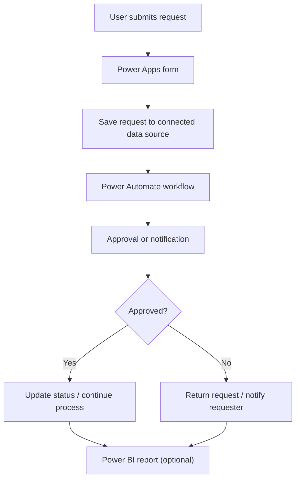
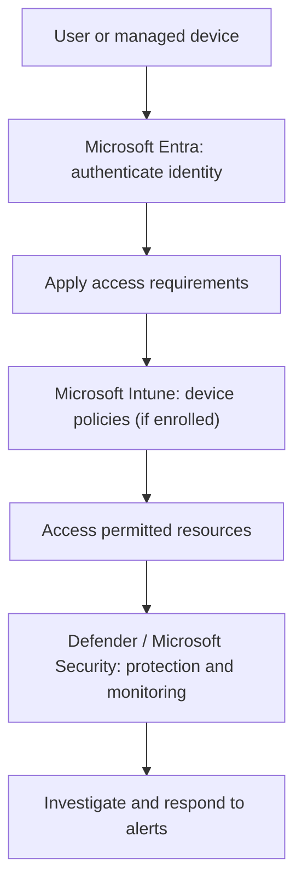
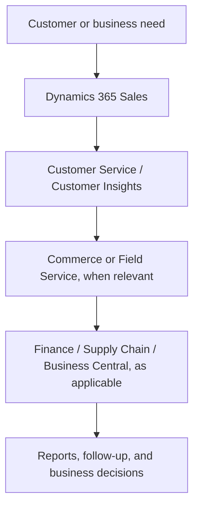
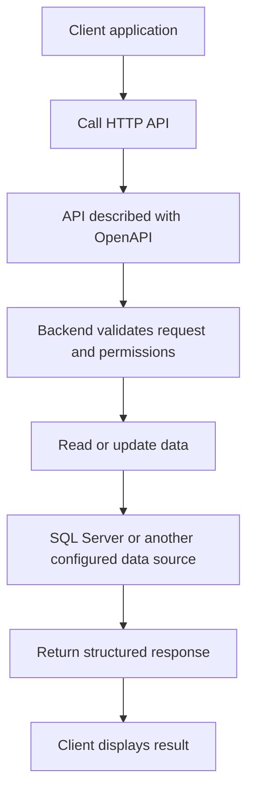

# Microsoft Products — Complete Product Directory Flowchart

This flowchart groups **all products and technologies visible in the supplied screenshots** by their main area. It is a directory map, not a sequence in which every product must be used.

```mermaid
flowchart TD
    A["Microsoft Products & Technologies"]

    A --> DEV["Development Languages & Frameworks"]
    DEV --> NET[".NET"]
    DEV --> MAUI[".NET MAUI"]
    DEV --> AC["Adaptive Cards"]
    DEV --> ASP["ASP.NET Core"]
    DEV --> CPP["C++"]
    DEV --> CS["C#"]
    DEV --> JAVA["Java"]

    A --> CLOUD["Cloud, Data & Developer Platforms"]
    CLOUD --> AZ["Azure"]
    CLOUD --> FAB["Microsoft Fabric"]
    CLOUD --> GRAPH["Microsoft Graph"]
    CLOUD --> ODATA["OData"]
    CLOUD --> OPENAPI["OpenAPI"]
    CLOUD --> PQ["Power Query M"]
    CLOUD --> SK["Semantic Kernel"]
    CLOUD --> SQL["SQL Server"]
    CLOUD --> VS["Visual Studio"]
    CLOUD --> VCPKG["vcpkg"]

    A --> DYN["Dynamics 365 Business Applications"]
    DYN --> D365["Dynamics 365"]
    DYN --> BC["Business Central"]
    DYN --> COM["Commerce"]
    DYN --> CI["Customer Insights"]
    DYN --> CSVC["Customer Service"]
    DYN --> FS["Field Service"]
    DYN --> FIN["Finance"]
    DYN --> GUIDES["Guides"]
    DYN --> HR["Human Resources"]
    DYN --> PO["Project Operations"]
    DYN --> RA["Remote Assist"]
    DYN --> SALES["Sales"]
    DYN --> SCM["Supply Chain Management"]
    DYN --> IND_D["Dynamics 365 Industry Clouds"]

    A --> M365["Microsoft 365, Collaboration & Employee Tools"]
    M365 --> M365S["Microsoft 365"]
    M365 --> AD["Microsoft Advertising"]
    M365 --> AGENT["Microsoft Agent 365"]
    M365 --> CLIP["Clipchamp"]
    M365 --> MCLOUD["Microsoft Cloud"]
    M365 --> COMPLY["Microsoft Compliance"]
    M365 --> COP["Microsoft Copilot"]
    M365 --> COPST["Copilot Studio"]
    M365 --> EDGE["Microsoft Edge"]
    M365 --> MESH["Microsoft Mesh"]
    M365 --> TEAMS["Microsoft Teams"]
    M365 --> TYPO["Microsoft Typography"]
    M365 --> VIVA["Microsoft Viva"]

    A --> POWER["Power Platform & Analytics"]
    POWER --> PP["Power Platform"]
    POWER --> APPS["Power Apps"]
    POWER --> AUTOMATE["Power Automate"]
    POWER --> BI["Power BI"]
    POWER --> PAGES["Power Pages"]

    A --> SEC["Security, Identity & Device Management"]
    SEC --> DEF["Microsoft Defender"]
    SEC --> ENTRA["Microsoft Entra"]
    SEC --> INTUNE["Microsoft Intune"]
    SEC --> PRIVA["Microsoft Priva"]
    SEC --> PURVIEW["Microsoft Purview"]
    SEC --> MSSEC["Microsoft Security"]

    A --> INFRA["Windows, Infrastructure & Administration"]
    INFRA --> WIN["Windows"]
    INFRA --> WINS["Windows Server"]
    INFRA --> SC["System Center"]
    INFRA --> SYS["Sysinternals"]
    INFRA --> LIFE["Microsoft Lifecycle Policy"]

    A --> OTHER["Other Technologies & Services"]
    OTHER --> BIZ["BizTalk Server"]
    OTHER --> DAX["DAX"]
    OTHER --> IND["Microsoft Industry Clouds"]
    OTHER --> PARTNER["Partner Center"]
    OTHER --> PLAY["PlayReady"]
    OTHER --> SURFACE["Surface"]
    OTHER --> SPECS["Open Specifications"]
```

## Typical solution flowcharts

These show common ways products work together in practical projects. Exact integrations depend on configuration, permissions, licensing, and product versions.

### 1. Build and publish an application

### 2. Data analytics and reporting

### 3. Business app and workflow automation

### 4. Identity and device protection

### 5. Customer and business operations with Dynamics 365

### 6. API integration

## How to use in GitHub
1. Save this file as `product-flowcharts.md` or copy the diagrams into your repository README.
2. GitHub supports Mermaid diagrams in Markdown code fences labeled `mermaid`.
3. Keep the directory map and practical workflow diagrams as separate sections so readers understand that the first is a product classification, while the others are example processes.
